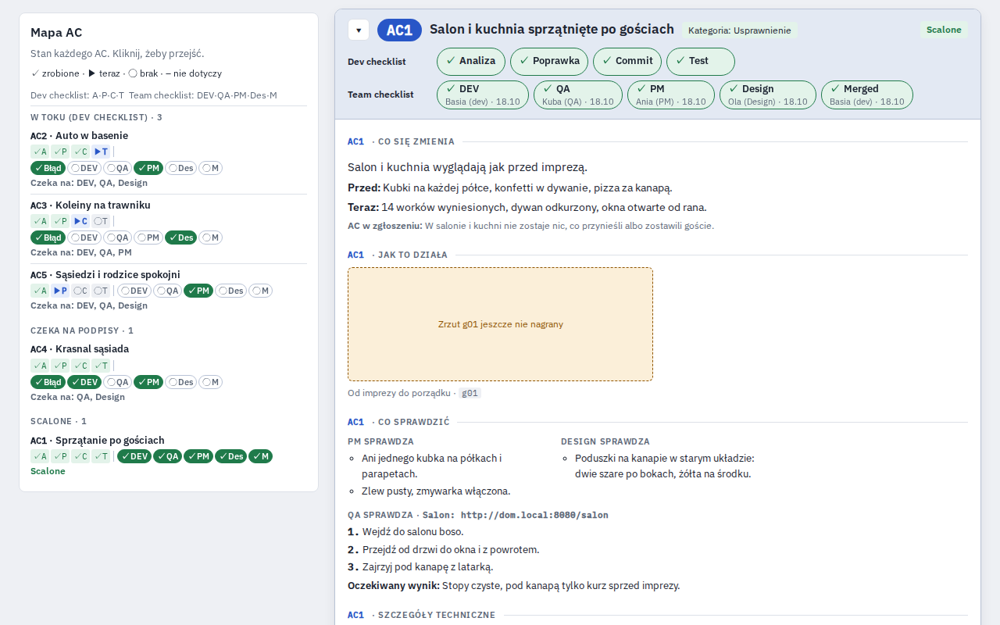

# tuned.board

A Claude Code skill that turns one ticket into a shared web page. The page shows the work that was done, split into acceptance criteria (ACs). PM, Design and QA read what changed, check it and sign off, right on the page.



The screenshot shows the example board, a made-up house party clean-up. Its text is in Polish. The page labels also come in English: set `"language": "en"` in your board file.

## What is on a board

- One card per AC: what changes, what it was before, what it is now.
- A Dev checklist with proof for each step: analysis, fix, commit, test.
- A click-through player with frames of the change.
- What PM, Design and QA should check, and the result to expect.
- Sign-off buttons for each role. One click signs with your name and date, a second click undoes.
- A note and a discussion on each AC.
- A map of all ACs, so you see at a glance who still has to sign.
- An optional code diff panel. With it the page contains your source code, so share it only with people who may read that code.

The board lives as a private Artifact on claude.ai. You choose who gets the link. Sign-offs, notes and messages are stored with the Artifact.

## What you need

- Claude Code with Artifacts.
- Python 3, to build the page.
- Docker, only to record click-through frames or to render preview shots.

## Install

```sh
git clone https://github.com/zdzislawbela/skills.git
cp -R skills/skills/tuned-board ~/.claude/skills/tuned-board
```

Start a new Claude Code session. Update and uninstall steps are in [INSTALL.md](INSTALL.md).

## Example

Ask Claude Code:

> Make a tuned.board for ticket ABC-123. Split the work on this branch into ACs, and write the labels in English.

Claude writes a `board.json`, builds the page and publishes it. You get a link to share with your team. Later, ask it to add an AC or update the board: sign-offs and comments stay.

To see the example board without publishing anything, run this in the skill folder:

```sh
mkdir -p /tmp/board/seed
python3 scripts/build.py examples/template-board.json --out /tmp/board/page.html --seed /tmp/board/seed.json --seed-files /tmp/board/seed --embed-missing
open /tmp/board/page.html
```

Opened this way the page is read only. The live parts work once it is published as an Artifact. `open` is the macOS command; on Linux use `xdg-open`.

All the details are in [SKILL.md](SKILL.md). The full shape of a board is in [examples/template-board.json](examples/template-board.json).

## License

MIT, like the rest of this repo.
